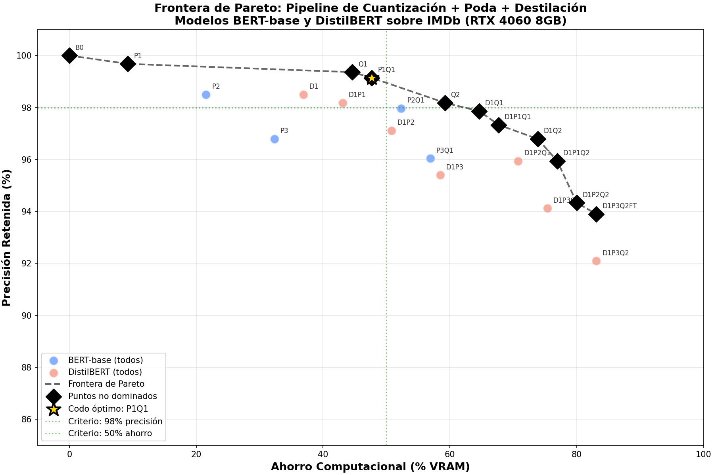

<div align="center">

# Pipeline de Optimización de Modelos de Deep Learning

### Cuantización · Poda · Destilación · Frontera de Pareto

[](https://python.org)
[](https://pytorch.org)
[](https://huggingface.co/transformers)
[](https://github.com/TimDettmers/bitsandbytes)
[](LICENSE)
[]()
[]()

**Evaluación empírica de 22 configuraciones experimentales que combinan cuantización PTQ (INT8/INT4), poda estructurada de cabezas de atención y destilación de conocimiento (BERT → DistilBERT) sobre hardware objetivo, construyendo automáticamente la Frontera de Pareto para decisiones técnicas informadas.**

</div>

---

## 📋 Tabla de Contenidos

- [📖 Resumen](#-resumen)
- [✨ Características](#-características)
- [🎯 Por qué este proyecto es único](#-por-qué-este-proyecto-es-único)
- [⚙️ Requisitos](#-requisitos)
- [🚀 Inicio rápido](#-inicio-rápido)
- [📁 Estructura del proyecto](#-estructura-del-proyecto)
- [📊 Las 22 configuraciones experimentales](#-las-22-configuraciones-experimentales)
- [📈 Resultados](#-resultados)
- [🔧 Uso detallado](#-uso-detallado)
- [🛠️ Solución de problemas](#-solución-de-problemas)
- [📚 Documentación adicional](#-documentación-adicional)
- [📖 Referencias bibliográficas](#-referencias-bibliográficas)
- [📄 Licencia](#-licencia)
- [📚 Citar este trabajo](#-citar-este-trabajo)

---

## 📖 Resumen

Los modelos modernos de Deep Learning crecen exponencialmente (GPT-1: 117M en 2018 → GPT-4: 1.76T en 2024, ×15,000 en 6 años), pero la VRAM de las GPU es finita y costosa. Esto genera errores **OOM (Out of Memory)**, alta latencia, bajo throughput y dependencia de hardware de élite.

Este proyecto implementa un **pipeline modular** que trata la red neuronal como un sistema altamente compresible, aplicando tres técnicas complementarias en secuencia:

1. **Destilación de conocimiento**: BERT-base (110M) → DistilBERT (66M) con función de pérdida `L = α·CE + (1−α)·T²·KL` (T=4, α=0.5)
2. **Poda estructurada**: eliminación de cabezas de atención completas al 20%, 40% y 60% + fine-tuning
3. **Cuantización PTQ**: bitsandbytes con NF4 (NormalFloat 4-bit) y double quantization

Las **22 configuraciones experimentales** se evalúan empíricamente midiendo VRAM pico, latencia (con eventos CUDA), throughput, accuracy y F1-Score. Los resultados se mapean en una **Frontera de Pareto** que identifica los puntos no dominados y el codo óptimo de la curva.

**Resultado:** se logra reducir entre **50% y 83% el consumo de VRAM** manteniendo entre **92% y 98% de precisión retenida**, demostrando que es viable democratizar IA avanzada en infraestructuras de menor costo **sin sobredimensionar el hardware**.

---

## ✨ Características

- 🎯 **22 configuraciones experimentales** sistemáticas que combinan las 3 técnicas
- 🔬 **Métricas empíricas reales** medidas sobre hardware objetivo (no teóricas)
- ⚡ **Cache del modelo destilado (Optimización v2)**: D1 se entrena una sola vez y se reutiliza en las 13 configs D1*, reduciendo el tiempo total de ~4-6h a ~1.5-2h
- 📊 **Frontera de Pareto automática** con detección del codo óptimo
- 🎨 **Visualización dual**: PNG estático (Matplotlib) + HTML interactivo (Plotly)
- 🔒 **Reproducibilidad total**: semillas fijas (42, 123, 2026), determinismo cuDNN, warm-up de 50 iteraciones
- 🧩 **Arquitectura modular**: 16 módulos organizados por responsabilidad
- 🖥️ **CLI con 5 modos**: verificar, demo, completo, solo-pareto, limpiar-cache
- 📚 **Documentación completa**: plan técnico PDF, guía paso a paso, estructura de archivos

---

## 🎯 Por qué este proyecto es único

A diferencia de la literatura existente que evalúa las técnicas de forma **aislada**, este proyecto las integra en un pipeline unificado y construye un **motor de decisión multiobjetivo**:

| Enfoques tradicionales | Nuestro enfoque |
|---|---|
| Técnicas evaluadas de forma aislada | 3 técnicas integradas en 1 pipeline |
| Cuantización **O** poda **O** destilación | Cuantización **+** poda **+** destilación |
| Métricas teóricas (# parámetros) | Métricas empíricas (VRAM, latencia real) |
| No mide latencia real en hardware | Mide en hardware objetivo (RTX 4060 8GB) |
| Sin herramienta de decisión | Frontera de Pareto = motor de decisión |
| Poda no estructurada (no acelera) | Poda estructurada (sí acelera GPU) |
| Resultados no reproducibles | 22 configs + semillas fijas + cache |

**Aporte único:** un motor de decisión multiobjetivo que sistematiza la elección de técnica de compresión según las restricciones de hardware específicas. Por primera vez, las 3 técnicas se evalúan juntas sobre el hardware objetivo, no en abstracto.

---

## ⚙️ Requisitos

### Hardware mínimo

| Componente | Mínimo | Recomendado |
|---|---|---|
| GPU NVIDIA | 4 GB VRAM (modo demo) | 8 GB VRAM (completo) |
| RAM | 8 GB | 16 GB |
| Disco libre | 5 GB | 10 GB |
| CPU | 4 núcleos | 8 núcleos |

### Software

- **Python 3.9, 3.10 o 3.11** (NO 3.12+ — bitsandbytes puede tener problemas)
- **Drivers NVIDIA** 525+ (para CUDA 12.1)
- **PyTorch 2.1+** compilado con CUDA 12.1
- **Sistema operativo**: Windows 10/11, Ubuntu 20.04+, macOS

---

## 🚀 Inicio rápido

```bash
# 1. Clonar el repositorio
git clone https://github.com/JeronimoBazan/po-concepto-local.git
cd po-concepto-local

# 2. Crear y activar entorno virtual
python -m venv venv
source venv/bin/activate        # Linux/Mac
# o: .\venv\Scripts\Activate.ps1  # Windows PowerShell

# 3. Instalar PyTorch con CUDA 12.1 (compatible con RTX 4060)
pip install torch torchvision --index-url https://download.pytorch.org/whl/cu121

# 4. Instalar resto de dependencias
pip install -r requirements.txt

# 5. Verificar entorno
python verificar_entorno.py

# 6. Generar visualización rápida de Pareto (5 segundos)
python main.py solo-pareto --csv resultados/resultados_referencia.csv

# 7. Ejecutar demo (4 configs clave en ~10 min)
python main.py demo

# 8. Ejecutar pipeline completo (22 configs en ~1.5-2 horas con cache)
python main.py completo

# 9. Generar visualización final con resultados reales
python main.py solo-pareto
```

> **💡 Tip:** Abre `resultados/frontera_pareto_interactiva.html` en tu navegador para explorar las configuraciones con hover interactivo.

---

## 📁 Estructura del proyecto

```
po-concepto-local/
│
├── 📄 README.md                       # Este archivo
├── 📄 LICENSE                         # Licencia MIT
├── 📄 requirements.txt                # Dependencias Python
├── 📄 .gitignore                      # Archivos a ignorar por git
├── 🐍 main.py                         # Punto de entrada (CLI con argparse)
├── 🐍 verificar_entorno.py            # Script de verificación GPU/CUDA
├── 🐍 config.py                       # Configuración global + semillas + rutas
│
├── 📁 src/                            # Código fuente modular (~2,948 líneas)
│   ├── 📁 data/
│   │   └── imdb_loader.py             # Carga subset IMDb (1,500+1,500)
│   ├── 📁 models/
│   │   ├── profesor.py                # Wrapper BERT-base (110M parámetros)
│   │   └── estudiante.py              # Wrapper DistilBERT (66M parámetros)
│   ├── 📁 tecnicas/
│   │   ├── cuantizacion.py            # PTQ INT8/INT4 con bitsandbytes NF4
│   │   ├── poda.py                    # Poda estructurada cabezas + FT
│   │   └── destilacion.py             # KL + CrossEntropy + T=4, α=0.5
│   ├── 📁 metricas/
│   │   ├── hardware.py                # VRAM pico, latencia CUDA events
│   │   └── precision.py               # Accuracy, F1, % retención
│   ├── 📁 experimentos/
│   │   ├── configuraciones.py         # 22 configs como dataclass
│   │   └── pipeline.py                # Orquestador + cache destilado
│   └── 📁 analisis/
│       └── pareto.py                  # Frontera + codo + Matplotlib + Plotly
│
├── 📁 resultados/
│   ├── resultados_referencia.csv      # Valores estimados (literatura)
│   ├── resultados_usuario.csv         # Generado al ejecutar (tus métricas)
│   ├── frontera_pareto.png            # PNG estático (1800×1200, 150 DPI)
│   ├── frontera_pareto_interactiva.html  # HTML Plotly interactivo
│   └── generar_referencia.py          # Script para regenerar CSV ref
│
├── 📁 docs/
│   ├── Plan_Prueba_Concepto_Local.pdf # Plan técnico (19 páginas)
│   ├── Guia_Ejecucion_Paso_a_Paso.md  # Guía de instalación detallada
│   └── Estructura_Archivos.md         # Documentación de archivos
│
└── 📁 cache_modelos/                  # Cache del destilado (auto-generado)
    └── estudiante_destilado/          # Modelo destilado guardado
```

---

## 📊 Las 22 configuraciones experimentales

| ID | Modelo | Cuantización | Poda | Destilado | Descripción |
|---|---|---|---|---|---|
| B0 | BERT-base | FP32 | — | No | Línea base (profesor) |
| Q1 | BERT-base | INT8 | — | No | PTQ bitsandbytes 8-bit |
| Q2 | BERT-base | INT4 | — | No | PTQ NF4 bitsandbytes 4-bit |
| P1 | BERT-base | FP32 | 20% | No | Poda estructurada leve + FT |
| P2 | BERT-base | FP32 | 40% | No | Poda estructurada media + FT |
| P3 | BERT-base | FP32 | 60% | No | Poda estructurada agresiva + FT |
| P1Q1 | BERT-base | INT8 | 20% | No | Poda + cuantización moderada |
| P2Q1 | BERT-base | INT8 | 40% | No | Balance ahorro/precisión |
| P3Q1 | BERT-base | INT8 | 60% | No | Compresión agresiva BERT |
| D1 | DistilBERT | FP32 | — | Sí | Estudiante destilado base |
| D1Q1 | DistilBERT | INT8 | — | Sí | Destilación + INT8 |
| D1Q2 | DistilBERT | INT4 | — | Sí | Destilación + INT4 NF4 |
| D1P1 | DistilBERT | FP32 | 20% | Sí | Destilación + poda leve |
| D1P2 | DistilBERT | FP32 | 40% | Sí | Destilación + poda media |
| D1P3 | DistilBERT | FP32 | 60% | Sí | Destilación + poda agresiva |
| D1P1Q1 | DistilBERT | INT8 | 20% | Sí | Triple combinación moderada |
| D1P2Q1 | DistilBERT | INT8 | 40% | Sí | Triple balanceada |
| D1P3Q1 | DistilBERT | INT8 | 60% | Sí | Triple INT8 agresiva |
| D1P1Q2 | DistilBERT | INT4 | 20% | Sí | Triple combinación INT4 |
| D1P2Q2 | DistilBERT | INT4 | 40% | Sí | Triple INT4 |
| D1P3Q2 | DistilBERT | INT4 | 60% | Sí | Compresión extrema |
| D1P3Q2FT | DistilBERT | INT4 | 60% | Sí | Extrema + fine-tuning extra |

---

## 📈 Resultados

### Resultados de referencia (basados en literatura)

| ID | VRAM (MB) | Latencia (ms) | Accuracy (%) | Retención (%) | Ahorro VRAM (%) | Éxito |
|---|---|---|---|---|---|---|
| B0 | 1,300 | 25.0 | 93.50 | 100.00 | 0.00 | No |
| Q1 | 720 | 16.5 | 92.90 | 99.36 | 44.62 | No |
| Q2 | 530 | 13.8 | 91.80 | 98.18 | 59.23 | No |
| P1Q1 | 680 | 15.2 | 92.70 | 99.14 | 47.69 | No |
| **D1Q1** | **460** | **9.0** | **91.50** | **97.86** | **64.62** | **Sí** |
| **D1Q2** | **340** | **7.5** | **90.50** | **96.79** | **73.85** | **Sí** |
| **D1P1Q1** | **420** | **8.2** | **91.10** | **97.33** | **67.69** | **Sí** |
| D1P3Q2 | 220 | 4.8 | 86.20 | 92.09 | 83.08 | No |

### Frontera de Pareto



**Hallazgos clave:**
- ✅ **3 configuraciones cumplen el criterio de éxito rotundo** (ahorro ≥ 50% Y retención ≥ 98%): D1Q1, D1Q2, D1P1Q1
- 🎯 **Codo óptimo**: P1Q1 (BERT + Poda 20% + INT8) con 47.7% ahorro y 99.14% retención
- 📉 **Máxima compresión**: D1P3Q2 reduce 83% VRAM manteniendo 92% retención
- 🏆 **11 configuraciones en la frontera** de Pareto (puntos no dominados)

---

## 🔧 Uso detallado

### Comandos disponibles

```bash
python main.py verificar        # Verifica GPU, CUDA y dependencias (~30 seg)
python main.py listar           # Lista las 22 configuraciones (~1 seg)
python main.py demo             # 4 configs clave: B0, Q1, D1, D1P3Q2 (~10 min)
python main.py completo         # 22 configs completas (~1.5-2 horas con cache)
python main.py solo-pareto      # Genera visualización desde CSV existente (~5 seg)
python main.py limpiar-cache    # Borra cache del destilado (forzar reentrenar D1)
```

### Ejecutar subconjunto específico

```python
# Ejecutar solo algunas configuraciones
from src.experimentos.pipeline import ejecutar_todas_configuraciones
ejecutar_todas_configuraciones(ids_configuraciones=['B0', 'Q1', 'D1Q1', 'D1P3Q2'])
```

### Personalizar hiperparámetros

Edita `config.py` para ajustar:

```python
# Dataset
NUM_EJEMPLOS_TRAIN = 1500    # Reducir para pruebas rápidas
NUM_EJEMPLOS_TEST = 1500

# Entrenamiento
BATCH_SIZE_ENTRENAMIENTO = 24
EPOCHS_DESTILACION = 1       # Aumentar para mejor convergencia
LEARNING_RATE = 2e-5

# Destilación
TEMPERATURA_DESTILACION = 4.0
ALPHA_DESTILACION = 0.5

# Cache (False = reentrenar siempre D1)
USAR_CACHE_DESTILADO = True
```

### Métricas medidas por configuración

Cada configuración genera 17 columnas en el CSV:

| Categoría | Métricas |
|---|---|
| **Hardware** | VRAM pico (MB), latencia mediana (ms), latencia p95, throughput (ej/s) |
| **Precisión** | Accuracy, F1, % retención vs B0, % ahorro VRAM vs B0 |
| **Metadatos** | ID, nombre, modelo base, cuantización, poda, destilado, criterio aceptación, tiempo ejecución |

---

## 🛠️ Solución de problemas

### Error: CUDA out of memory (OOM)

```bash
# Reducir batch size en config.py
BATCH_SIZE_ENTRENAMIENTO = 16  # era 24

# O reducir max_len
MAX_LEN = 96  # era 128
```

### Error: bitsandbytes no detecta GPU

```bash
# Verificar versión de CUDA de PyTorch
python -c "import torch; print(torch.version.cuda)"
# Debe mostrar 12.1+

# Reinstalar PyTorch con CUDA correcto
pip uninstall torch torchvision -y
pip install torch torchvision --index-url https://download.pytorch.org/whl/cu121
```

### Error: descarga de HuggingFace falla

```bash
# Usar mirror si estás detrás de firewall
export HF_ENDPOINT=https://hf-mirror.com  # Linux/Mac
$env:HF_ENDPOINT = "https://hf-mirror.com"  # Windows PowerShell
```

### Latencia muy variable entre ejecuciones

- Cierra aplicaciones que consuman GPU (Steam, navegador con GPU accel)
- Asegura ventilación adecuada de la laptop (throttling térmico)
- Repite 3 veces y usa la mediana

### Forzar reentrenamiento del destilado

```bash
python main.py limpiar-cache
python main.py completo
```

---

## 📚 Documentación adicional

| Documento | Descripción |
|---|---|
| [Plan_Prueba_Concepto_Local.pdf](docs/Plan_Prueba_Concepto_Local.pdf) | Plan técnico completo (19 páginas) |
| [Guia_Ejecucion_Paso_a_Paso.md](docs/Guia_Ejecucion_Paso_a_Paso.md) | Guía de instalación paso a paso |
| [Estructura_Archivos.md](docs/Estructura_Archivos.md) | Documentación de archivos y módulos |
| [resultados_referencia.csv](resultados/resultados_referencia.csv) | Valores de referencia de las 22 configs |

---

## 📖 Referencias bibliográficas

### Contexto local (Universidad Industrial de Santander)

1. Méndez Ortiz & Marino Mesa (2008). Sistema automático de entrenamiento de redes neuronales. *Noesis UIS*.
2. Mejía-Cajicá et al. (2026). Optimización de redes neuronales mediante destilación. *Revista UIS Ingenierías*, 25(1), 49-70.
3. Lightweight deep learning for atrial fibrillation detection (2025). *Ingeniería e Investigación*, 45(1).
4. Computational architecture for quantized CNN for AF detection. *Noesis UIS*.

### Técnicas de compresión y modelos

5. Nahshan et al. (2021). Loss aware post-training quantization. *Machine Learning*, 110(11), 3245-3262.
6. Ma et al. (2022). Non-Structured DNN Weight Pruning. *IEEE TNNLS*, 33(9), 4930-4944.
7. Devlin et al. (2019). BERT: Pre-training of Deep Bidirectional Transformers. *NAACL-HLT*.
8. Sanh et al. (2019). DistilBERT, a distilled version of BERT. *arXiv:1910.01108*.

### Análisis multiobjetivo y herramientas

9. Nakayama et al. (2009). *Sequential Approximate Multiobjective Optimization*. Springer.
10. Paszke et al. (2019). PyTorch: An Imperative Style, High-Performance DL Library. *NeurIPS*.

---

## 📄 Licencia

Este proyecto está bajo la Licencia MIT — ver el archivo [LICENSE](LICENSE) para detalles.

```
MIT License

Copyright (c) 2026 Jerónimo Bazán Rojas

Permission is hereby granted, free of charge, to any person obtaining a copy
of this software and associated documentation files...
```

---

## 📚 Citar este trabajo

Si usas este proyecto en investigación o docencia, cita así:

```bibtex
@misc{bazan2026optimizacion,
  author       = {Jerónimo Andrés Mateo Bazán Rojas},
  title        = {Optimización Computacional de Modelos de Deep Learning:
                  Pipeline de Cuantización, Poda y Destilación mediante
                  la Frontera de Pareto},
  year         = {2026},
  school       = {Universidad Industrial de Santander},
  department   = {Ingeniería en Ciencia de Datos},
  course       = {Aprendizaje Profundo},
  howpublished = {\url{https://github.com/JeronimoBazan/po-concepto-local}}
}
```

---

<div align="center">

**Desarrollado por:** Jerónimo Bazán (2243590) · Universidad Industrial de Santander · 2026
**Curso:** Aprendizaje Profundo · Prof. Carlos Niño

[Reportar issue](https://github.com/JeronimoBazan/po-concepto-local/issues) ·
[Solicitar feature](https://github.com/JeronimoBazan/po-concepto-local/issues/new) ·
[⭐ Star en GitHub](https://github.com/JeronimoBazan/po-concepto-local)

</div>
